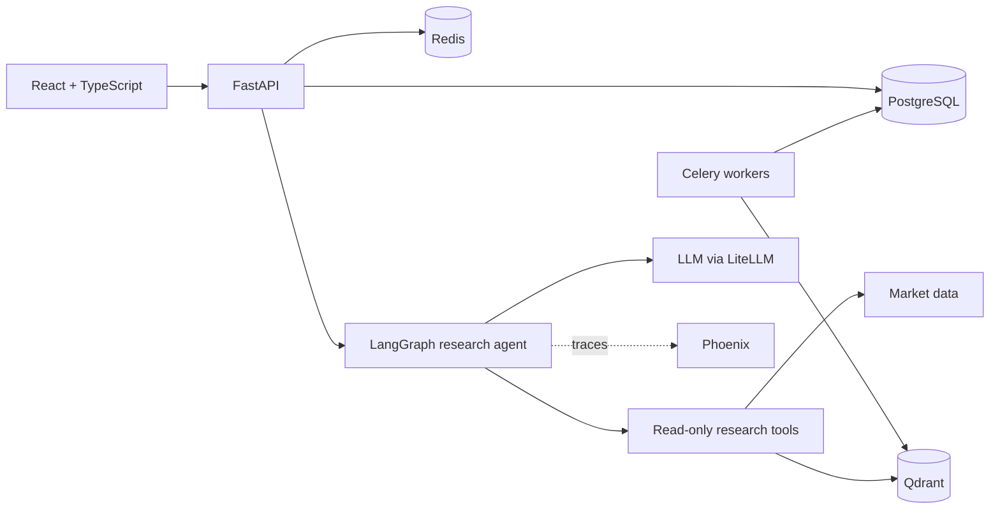

# DeltaTracker

### Indian equity research, portfolio tracking, and an evidence-checking AI research agent

DeltaTracker brings stock research and portfolio workflows together for NSE/BSE equities.
Its research agent combines market data and retrieved documents, cites its sources, and
checks whether the evidence supports its answer.

**Project showcase · Application source maintained privately**

## What it does

- **Research with citations:** ask a market question, inspect the agent's tool timeline, and
  see an answer labelled grounded, partial, or insufficient according to its evidence checks.
- **Track a portfolio:** record holdings and transactions, import broker files, and inspect
  FIFO tax lots and rebalancing previews.
- **Monitor the market:** maintain watchlists with notes and tags, view charts and price
  updates, browse news, and discover stocks across the NIFTY 50.
- **Inspect signals:** rule-based technical and fundamental signals with explanations and
  risk-profile settings.

## Engineering focus

The research workflow uses a LangGraph state machine with bounded tool calls, input and
output guards, and a claim verifier. Retrieved news and company profiles are stored in
Qdrant; citations connect answers to their sources. Unsupported claims can trigger one
additional evidence-gathering pass.

The project includes offline agent tests, backend tests, a frontend type check and build,
a Docker Compose smoke test, and a Git history secret scan in CI. A reproducible evaluation
harness uses frozen data and supports comparing the agent with and without verification.
Evaluation results have not yet been published; the golden set awaits human review.

## Architecture

| Layer | Technologies |
| --- | --- |
| Frontend | React, TypeScript, Vite, Tailwind CSS, TanStack Query, Recharts |
| Backend | Python, FastAPI, PostgreSQL, Redis, Celery |
| Research | LangGraph, LiteLLM, Qdrant, FastEmbed |
| Delivery and observability | Docker Compose, GitHub Actions, Phoenix / OpenTelemetry |

## Current boundaries

Forecast bands currently use a statistical random-walk baseline. FinBERT sentiment and a
LightGBM ensemble have training scaffolding but no trained models deployed. Agent streaming,
hybrid retrieval and broader frontend tests remain roadmap items.

Market data can be delayed. Tax previews require validation against current rules before
reliance. DeltaTracker is educational software and does not provide investment advice.

## Repository scope

This public repository contains the project presentation. Application code, configuration,
credentials and deployment infrastructure are maintained separately. A verified live demo
link will be added after hosting is configured.
